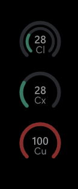

# AIMeter for Windows

A small always-on-top overlay that shows how much of your **Claude**, **Codex**
and **Cursor** usage limits you've used. A stack of arc gauges sits quietly in
the top-right corner of your screen. Clicks pass straight through it, and it
hides while a fullscreen app or game is running.

This is the Windows companion to [AIMeter for macOS](https://github.com/acceleroto/aimeter).

<p align="center">
  
</p>

> **Unofficial.** AIMeter is not affiliated with Anthropic, OpenAI or Anysphere.
> It reads the same usage pages you see when you're signed in to each site. If a
> provider changes those pages, AIMeter may stop working until it's updated.

## Reading the gauges

Each gauge shows the percent used, with the provider's abbreviation under the number.

| Gauge | Outer arc | Inner arc | Number in the middle |
|---|---|---|---|
| **Cl** Claude | Weekly limit | 5-hour limit | 5-hour |
| **Cx** Codex | Weekly limit | 5-hour limit, if your plan has one | Shortest limit |
| **Cu** Cursor | Monthly Auto allowance | Monthly API allowance, on paid plans | Whichever is fuller |

- Arcs turn **amber** at 75% and **red** at 90%. You can change both thresholds.
- **Dimmed** means the numbers are out of date because the last few refreshes failed.
- A **dashed ring with "–"** means the provider is connected but AIMeter has no
  current numbers. Usually the sign-in expired. Reconnect it in Settings.
- Providers you haven't connected don't appear.

## Install

Requires Windows 10 or 11 (64-bit). Nothing else is needed: .NET is bundled in
the download, and the Microsoft Edge WebView2 Runtime is already part of Windows.

1. Download **`AIMeterForWindows-win-Setup.exe`** from the
   [latest release](https://github.com/acceleroto/aimeter-windows/releases/latest).
2. Run it. AIMeter installs for your user only (no admin prompt) and starts.

**"Windows protected your PC"?** The installer isn't code-signed, so Microsoft
Defender SmartScreen may warn the first time. Click **More info**, then
**Run anyway**. If you'd rather not, [build it from source](#build-from-source).

AIMeter **updates itself**. It checks GitHub for new releases every few hours,
downloads them in the background, and installs them when you quit. If you don't
want to wait, the tray menu shows **Restart to update**.

To **uninstall**, go to **Settings → Apps → Installed apps → AIMeter**. Your
settings and sign-ins stay in `%LOCALAPPDATA%\AIMeter`. Delete that folder to
remove them too.

A portable zip is also attached to each release if you don't want to install
it. The portable copy doesn't update itself.

## Getting started

1. Run AIMeter. An AIMeter icon appears in the system tray and Settings opens.
2. Under **Providers**, click **Connect** for each service you use and sign in
   in the window that opens. It closes on its own once usage loads.
3. Gauges appear in the top-right corner.

Right-click the tray icon for **Refresh now**, **Settings…** and **Quit**.

In **Settings** you can also:

- Change gauge size and opacity
- Click **Move overlay** to drag the gauges somewhere else. The position is
  remembered for each monitor setup.
- Turn the thin dark edge and the usage colors on or off
- Choose how often to refresh (default 5 minutes)
- Turn **Start with Windows** on or off (on by default)

## Privacy

- AIMeter signs in to each provider in its own built-in browser (WebView2),
  separate from your normal browser. Your sign-ins stay on your PC.
- To get usage, it opens the provider's own usage page in a hidden window and
  asks that page for the same numbers the page shows you.
- Nothing is sent anywhere else. There's no telemetry, no analytics and no
  server of ours.
- Everything is stored in `%LOCALAPPDATA%\AIMeter`: settings, the last usage
  numbers, a short log and the browser profiles. Disconnecting a provider
  clears its browser data. Deleting that folder removes everything.

## Build from source

Requires the [.NET 10 SDK](https://dotnet.microsoft.com/download/dotnet/10.0).

```bash
git clone https://github.com/acceleroto/aimeter-windows.git
cd aimeter-windows
dotnet test
dotnet run --project src/AIMeter.App
```

Build output goes to `%LOCALAPPDATA%\AIMeterWin\build`, not the source folder,
so the project can live in a synced folder such as Dropbox or OneDrive.

| Folder | Contents |
|---|---|
| `src/AIMeter.Core` | Usage models, response parsers and gauge rules. No UI. |
| `src/AIMeter.App` | WPF overlay, tray icon, settings and WebView2 sign-in and refresh |
| `tests/AIMeter.Tests` | Unit tests for the parsers and gauge rules |

[DESIGN.md](DESIGN.md) covers the design and the endpoints each provider uses.

### Releasing

Push a version tag, for example `git tag v0.2.0 && git push origin v0.2.0`.
The [Release workflow](.github/workflows/release.yml) runs the tests, builds a
self-contained app, packs it with [Velopack](https://velopack.io) and publishes a
GitHub Release with the installer. Installed copies then pick up the update.

## Credits

The usage endpoints and the idea come from
[AIMeter](https://github.com/divyanshub024/aimeter) by divyanshub024 and the
[acceleroto/aimeter](https://github.com/acceleroto/aimeter) fork, both MIT licensed.
This Windows version is a separate codebase.

## License

[MIT](LICENSE)
